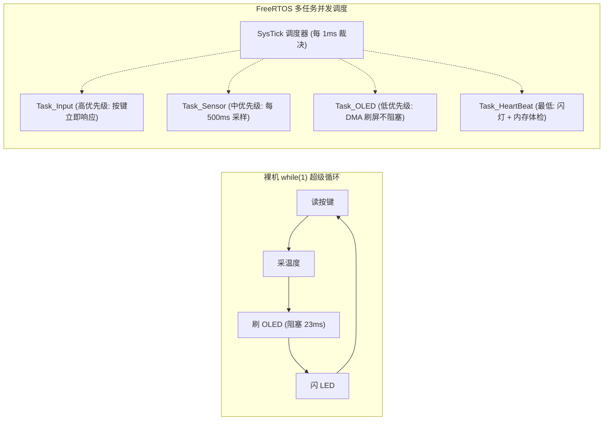
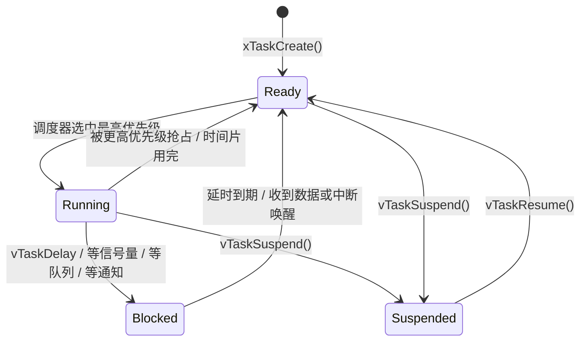
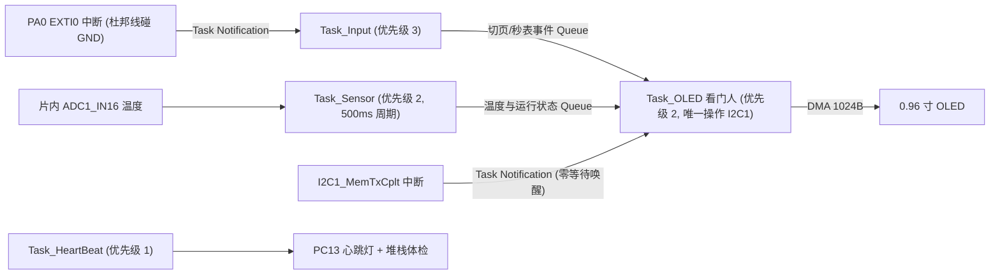

# STM32 HAL 库 + FreeRTOS 零基础实战教程
> **硬件配置**：STM32F103C8T6 核心板 + 0.96 英寸 4 针 OLED（I2C / SSD1306）  
> **软件载体**：STM32CubeMX + CMake + CLion 或 VS Code  
> **适用人群**：具备基础 C 语言能力、嵌入式零基础的研一新生

---

## 一、开始前必看：硬件补齐清单与防坑红线

你手头的两件核心硬件（STM32F103C8T6 + 0.96 寸 4 针 OLED）**完全足够学完 HAL 库核心外设与 FreeRTOS 多任务编程**，但**仅靠这两块板子无法把程序写进芯片**。请先核对以下必备配件：

### 1.1 必需/推荐配件检查表

| 物品 | 必要性 | 参考价 | 作用与选型建议 |
| :--- | :---: | :---: | :--- |
| **ST-Link V2 调试器** | **必需** | ¥10~15 | 支持 SWD 两线烧录 + **硬件单步断点调试**。不要用 CH340 串口下载替代——学 FreeRTOS 没有单步调试和任务堆栈查看会极其痛苦。 |
| **母对母杜邦线** | **必需** | ¥3~5 | 建议买 20cm、20~40 根一排，用来连 ST-Link、OLED 和模拟按键。 |
| **USB-TTL 模块 (CH340/CP2102)** | 强烈推荐 | ¥5~10 | 接板子串口看 `printf` 实时日志，定位 FreeRTOS 死机/内存溢出比只看 OLED 快得多。 |
| **轻触按键 / 面包板** | 可选 | ¥5 | **没买也能学**：用一根杜邦线一端插在 `PA0`，另一端轻碰 `GND` 即可完美模拟按键按下。 |

### 1.2 STM32F103C8T6 核心参数与隐藏陷阱

1. **资源红线（FreeRTOS 内存必须精打细算）**
   - 内核：ARM Cortex-M3，最高主频 **72 MHz**
   - Flash（存程序代码）：**64 KB**（部分批次实测 128 KB，但工程一律按 64 KB 设计）
   - SRAM（存变量与堆栈）：**20 KB** —— **这是 C8T6 跑 FreeRTOS 的最大约束**，随便多开几个任务或乱调浮点 `printf` 就会直接爆内存。
2. **国产替代芯片陷阱（OpenOCD 报错预警）**
   - 淘宝十几元的 C8T6 核心板有相当比例不是 ST 原装，而是国产引脚兼容片（CS32 / CKS32 / APM32 等），虽然代码基本通用，但芯片调试 ID 不同（原装为 `0x1ba01477`，兼容片常为 `0x2ba01477`）。
   - 如果后续烧录时 OpenOCD 报 `UNEXPECTED idcode: 0x2ba01477`，**不是板子坏了**，按本文第 2.3 节改一行 `CPUTAPID` 配置即可解决。
3. **板载 LED 确认**
   - 95% 的 Blue Pill（蓝板）板载 LED 接在 **`PC13`**，且为**低电平点亮**（输出 `0` 亮，输出 `1` 灭）。上电前目视确认板子丝印。

### 1.3 0.96 英寸 4 针 OLED 防烧指南

> [!CAUTION]
> **插线前务必核对 OLED 背面丝印！**  
> 市面 4 针 OLED 存在两种常见引脚顺序：`GND - VCC - SCL - SDA` 和 `VCC - GND - SCL - SDA`。**电源接反通电 2 秒即永久烧毁屏幕！** 统一使用 **3.3V** 供电。

- **通信协议**：4 针一定是 **I2C（IIC）** 接口。
- **驱动芯片**：0.96 寸绝大多数为 **SSD1306**（分辨率 `128 × 64` 像素）。
- **I2C 地址天坑**：屏幕背面标的地址通常是 `0x78`（8 位写地址），对应的 7 位地址是 `0x3C`。**STM32 HAL 库的所有 I2C 函数都需要传左移一位后的 8 位地址，即 `0x78`（`0x3C << 1`）**。

### 1.4 全程固定接线总表（一次接好，全教程不换线）

| 模块 | 模块引脚 | STM32F103C8T6 引脚 | 说明 |
| :--- | :--- | :--- | :--- |
| **ST-Link V2** | `SWCLK` | `SWCLK`（板子尾部 4 针排针） | 调试时钟线（对应 PA14） |
| | `SWDIO` | `SWDIO`（板子尾部 4 针排针） | 调试数据线（对应 PA13） |
| | `GND` | `GND` | 共地 |
| | `3.3V` | `3.3V` | 给核心板供电（接了它就**不要**同时插板子 Micro-USB/Type-C 口） |
| **0.96 寸 OLED** | `VCC` | `3.3V` | 严禁接反 |
| | `GND` | `GND` | 共地 |
| | `SCL` | **`PB6`** | 硬件 `I2C1_SCL` |
| | `SDA` | **`PB7`** | 硬件 `I2C1_SDA` |
| **模拟按键** | 杜邦线一端 | **`PA0`** | 另一端需要触发时轻碰 `GND`（下降沿外部中断） |
| **USB-TTL（可选）** | `RXD` | **`PA9`** (`USART1_TX`) | 注意交叉：`TX` 接 `RX` |
| | `TXD` | **`PA10`** (`USART1_RX`) | `RX` 接 `TX` |
| | `GND` | `GND` | 共地（**不要**接 USB-TTL 的 VCC，避免双电源冲突） |

---

## 二、第 0 阶段：零基础必备的 4 个核心心智模型

不要一上来就啃上千页的参考手册。先用计算机专业通用的 4 个概念把嵌入式思维打通：

### 2.1 寄存器 vs HAL 库
- **硬件本质**：STM32 里的每一个外设（GPIO 引脚、定时器、I2C 控制器）都被映射到了固定的 32 位内存地址上。往某个特定地址的某一位写 `1`，对应的物理引脚就输出 `3.3V` 高电平。这些特殊内存地址叫**寄存器（Register）**。
- **HAL 库的意义**：手写寄存器需要死记地址和位掩码，换一颗芯片就得重写。ST 官方的 **HAL（Hardware Abstraction Layer，硬件抽象层）库**用面向对象风格的 C 结构体（如 `I2C_HandleTypeDef hi2c1`）把底层寄存器操作封装成了标准函数（如 `HAL_GPIO_WritePin()`、`HAL_I2C_Mem_Write()`），并且由 **STM32CubeMX** 图形化工具自动生成初始化代码。

### 2.2 时钟树（Clock Tree）
- 上电后，STM32 为了极致省电，**默认把所有外设的时钟全部关闭**。没有时钟信号驱动的电路处于“断电静止”状态。
- C8T6 板载一颗 `8 MHz` 外部晶振（HSE），我们会在 CubeMX 里用锁相环（PLL）将其 9 倍频到 **`72 MHz`** 作为系统主频（SYSCLK），再分频给外设总线（APB2 最高 72 MHz，APB1 最高 36 MHz）。

### 2.3 阻塞、中断与 DMA（嵌入式性能三层境界）

假设你要“烧水（耗时操作）并同时扫地（其他任务）”：

| 机制 | 现实类比 | 代码特征 | CPU 利用率与适用场景 |
| :--- | :--- | :--- | :--- |
| **轮询 / 阻塞** | 死盯水壶直到水开，啥也不干 | `HAL_Delay(1000)`、`HAL_I2C_Mem_Write()` | 极低。仅用于开机初始化或极短延时。 |
| **中断 (Interrupt)** | 给水壶装哨子，先去扫地，哨响再关火 | `EXTI`、`HAL_TIM_PeriodElapsedCallback()` | 高。响应外部突发事件（按键、定时到达、单字节串口）。 |
| **DMA (直接内存访问)** | 请个机器人专门搬运数据，搬完喊你一声 | `HAL_I2C_Mem_Write_DMA()` | 极高。大批量数据搬运（如刷新 OLED 的 **1024 字节显存**），搬运期间 CPU 完全解放。 |

### 2.4 裸机超级循环 vs FreeRTOS



- **裸机的瓶颈**：所有功能串在同一个 `while(1)` 里，只要某一步耗时较长（例如阻塞刷新一次 OLED 需要约 `23 ms`），按键检测和定时控制就会卡顿；功能一多，状态机嵌套成一团乱麻。
- **FreeRTOS 的价值**：把复杂系统拆解成多个独立的小循环（**任务 Task**），每个任务有自己独立的**栈空间（Stack）**和**优先级（Priority）**。高优先级任务就绪时立即抢占 CPU；任务调用 `vTaskDelay()` 或等待信号量/队列时主动进入**阻塞态（Blocked）**，CPU 无缝切给其他任务，真正实现高响应、低耦合的工程架构。

---

## 三、第 1 阶段：现代化开发环境搭建（CubeMX + CLion / VS Code）

> [!TIP]
> **IDE 选型直接建议**：
> - **首选 CLion**：研一新生用学校 `.edu.cn` 邮箱即可申请 JetBrains **全套免费教育许可证**。CLion 对 CubeMX 生成的 CMake 工程和 OpenOCD 调试（含 **FreeRTOS 线程/堆栈实时视图**）集成度最高，踩坑最少。
> - **备选 VS Code**：如果你平时主力就是 VS Code，请使用 ST 官方推出的 **`STM32CubeCLT` + `STM32Cube for Visual Studio Code` 扩展**。不要去看 2022 年之前手动配置 Makefile + EIDE + 散装 JSON 的老教程，那些已经过时且容易配崩。

### 3.1 共同必装基础软件

1. **STM32CubeMX**（推荐 6.12 及以上版本，原生支持直接生成 **CMake** 工程）
   - 官网下载安装（需注册免费 ST 账号）。
   - 安装后打开一次，进入 `Help -> Manage embedded software packages`，安装 **STM32F1** 固件包（最新版如 `1.8.6` 即可）。
2. **STM32CubeCLT**（ST 官方命令行工具集，**CLion 和 VS Code 都强烈建议装这个**）
   - 一个安装包自动配齐：`arm-none-eabi-gcc` 交叉编译器、`CMake`、`Ninja` 构建工具、`ST-LINK GDB Server` 与 `STM32CubeProgrammer`，且自动配好环境变量，省去逐个找驱动和配 `PATH` 的麻烦。
3. **ST-Link USB 驱动**
   - Windows：安装 STM32CubeCLT / STM32CubeProgrammer 时会自动装好驱动；插入 ST-Link 后在设备管理器能看到 `STMicroelectronics STLink dongle`。
   - Linux（Ubuntu）：安装 `openocd` 并将 udev 规则放到 `/etc/udev/rules.d/`，或直接用 `STM32CubeCLT` 自带规则，确保普通用户无需 `sudo` 即可访问 ST-Link。

---

### 3.2 方案 A：CLion 配置流程（推荐）

#### 步骤 1：在 CubeMX 中创建 CMake 工程
1. 打开 CubeMX -> `ACCESS TO MCU SELECTOR` -> 搜索 `STM32F103C8T6` 并双击创建工程。
2. 切到顶部 `Project Manager` 标签页：
   - `Project Name`：`stm32_lab`（**路径与工程名严禁出现中文和空格**）。
   - `Toolchain / IDE`：选择 **`CMake`**（新版 CubeMX 直接支持，不要再选老教程里的 STM32CubeIDE）。
3. 切到左侧 `Code Generator`：
   - **务必勾选**：`Generate peripheral initialization as a pair of '.c/.h' files per peripheral`（让每个外设的初始化代码分文件存放，不要全堆在 `main.c`）。
   - 保留默认勾选：`Keep User Code when re-generating`。
4. 点击右上角 `GENERATE CODE`。

#### 步骤 2：在 CLion 中打开与配置工具链
1. 用 CLion 打开刚生成的工程文件夹，CLion 会自动识别根目录 `CMakePresets.json` 中的 `Debug` 配置。
2. 检查工具链：`Settings -> Build, Execution, Deployment -> Toolchains`，确认 `CMake`、`Ninja` 可用；编译工具由工程里的 `cmake/gcc-arm-none-eabi.cmake` 自动指定 `arm-none-eabi-gcc`。
   - 如果报错找不到 `arm-none-eabi-gcc`，将 `STM32CubeCLT` 下的 `GNU-tools-for-STM32/bin` 加入系统 `PATH` 后重启 CLion。
3. **配置 OpenOCD 烧录与调试**：
   - 安装 OpenOCD（Linux 直接 `sudo apt install openocd`；Windows 下载 xPack OpenOCD 解压并在 CLion `Settings -> Build, Execution, Deployment -> Embedded Development` 填入 `openocd.exe` 路径）。
   - 在工程根目录新建文件 `stlink_f103.cfg`：
     ```tcl
     source [find interface/stlink.cfg]
     transport select hla_swd

     # 关键防坑：设为 0 可同时兼容 ST 原装芯片 (0x1ba01477) 与国产兼容片 (0x2ba01477)
     set CPUTAPID 0

     source [find target/stm32f1x.cfg]
     reset_config none
     ```
   - 点击右上角运行配置 -> `Edit Configurations` -> `+` -> 选择 **`OpenOCD Download & Run`**：
     - `Target` & `Executable`：选你的工程 `.elf` 目标。
     - `Board config file`：选刚刚新建的 `stlink_f103.cfg`。
     - `Download`：`Updated Only` 或 `Always`；`Reset`：`Run`。
   - **开启 FreeRTOS 调试面板（CLion 王牌功能）**：`Settings -> Build, Execution, Deployment -> Embedded Development -> RTOS Integration` -> 勾选 **`Enable RTOS integration`**，选择 **`FreeRTOS`**。以后打断点暂停时，底部会直接列出每个任务的状态、优先级和实时栈使用率！

---

### 3.3 方案 B：VS Code 配置流程（官方 CMake 路线）

1. 确保已安装 **STM32CubeMX** 和 **STM32CubeCLT**。
2. 在 VS Code 扩展商店安装官方扩展：**`STM32Cube for Visual Studio Code`**（它会自动拉起 `CMake Tools`、`C/C++`、`Cortex-Debug` 等依赖）。
3. 同样在 CubeMX 中 `Toolchain / IDE` 选择 **`CMake`** 并生成代码。
4. 在 VS Code 左侧点击 ST 图标 -> `Import CMake project` -> 选择刚生成的工程目录 -> 选择预设 `Debug`。
5. 按 `F7`（或底部状态栏 `Build`）编译；按 `F5` 直接启动 `ST-LINK GDB Server` 一键烧录并进入单步调试。
   - 若遇到国产芯片导致 ST-LINK GDB Server 报非原装芯片拒绝连接，则改用 `Cortex-Debug` + OpenOCD，并复用上面第 3.2 节的 `stlink_f103.cfg`（设置 `CPUTAPID 0`）即可绕过校验。

---

### 3.4 CubeMX 工程两大铁律（必记！）

> [!IMPORTANT]
> 1. **USER CODE 保护区规则**：在 CubeMX 自动生成的文件（如 `main.c`、`stm32f1xx_it.c`）里，**自己写的所有代码必须严格放在 `/* USER CODE BEGIN ... */` 和 `/* USER CODE END ... */` 之间**。写在保护区外的代码，下次点 `GENERATE CODE` 会被无情清空！
> 2. **自定义驱动文件接入 CMake 的正确姿势**：CubeMX 6.12+ 生成的工程将自动构建脚本放在 `cmake/stm32cubemx/CMakeLists.txt`（绝不手改），而**根目录的 `CMakeLists.txt` 留给开发者管理自己的代码**。后续我们建 `User/` 目录放 OLED 驱动和 FreeRTOS 任务，只需在根目录 `CMakeLists.txt` 里追加源文件和头文件路径，重新生成 CubeMX 代码完全不受影响。

---

## 四、第 2 阶段：STM32 HAL 库 4 个递进实战实验

请严格按顺序逐个实验打通，每一个实验都是下一个实验和 FreeRTOS 的基石。

---

### 实验 1：点亮板载 LED 与跑通硬件调试（GPIO 输出）

**目标**：配置 72 MHz 系统时钟，控制 `PC13` 闪烁，并在 IDE 里打断点观察变量变化。

#### 1. CubeMX 精确配置
1. **`Pinout & Configuration -> System Core -> SYS`**：
   - `Debug`：**必须选择 `Serial Wire`！**
   > [!WARNING]
   > 如果漏配 `Serial Wire`，芯片烧完第一次程序后 SWD 调试口会被当作普通 IO 关闭，第二次烧录会报连接失败！  
   > **救砖方法**：把板子上的 `BOOT0` 跳线帽插到 `1`（靠近 3.3V），按一下复位键，重新烧录带 `Serial Wire` 的固件，再把 `BOOT0` 插回 `0`。
2. **`System Core -> RCC`**：
   - `High Speed Clock (HSE)`：选择 `Crystal/Ceramic Resonator`（启用外部 8 MHz 晶振）。
3. **`Clock Configuration` 标签页**：
   - `Input frequency` 确认是 `8` MHz。
   - `PLL Source Mux` 选 `HSE`。
   - `System Clock Mux` 选 `PLLCLK`。
   - 在 `HCLK (MHz)` 框里直接输入 **`72`** 并回车，CubeMX 会自动算好倍频和分频系数（APB1 = 36 MHz，APB2 = 72 MHz）。
4. **右侧芯片引脚图**：
   - 左键点击 `PC13` -> 选择 `GPIO_Output`。
   - 在 `System Core -> GPIO` 中点 `PC13`：`GPIO output level` 选 `High`（默认灭），`User Label` 填 `LED`。
5. 点击 `GENERATE CODE`。

#### 2. 代码编写（`Core/Src/main.c`）
在 `main()` 的 `while (1)` 保护区中写入：

```c
/* USER CODE BEGIN 2 */
uint32_t blink_cnt = 0;
/* USER CODE END 2 */

/* Infinite loop */
/* USER CODE BEGIN WHILE */
while (1)
{
    HAL_GPIO_TogglePin(LED_GPIO_Port, LED_Pin);
    blink_cnt++;
    HAL_Delay(500); // 阻塞延时 500ms（1Hz 闪烁）
    /* USER CODE END WHILE */

    /* USER CODE BEGIN 3 */
}
/* USER CODE END 3 */
```

#### 3. 验收标准
- 编译 0 Error，点击 Debug 烧录后，板载 LED 以 0.5 秒亮 / 0.5 秒灭规律闪烁。
- 在 `blink_cnt++;` 这一行左侧点一个红点（断点），点击 **Debug（小虫子图标）**：程序停在断点处，鼠标悬停在 `blink_cnt` 上能看到实时数值，按 `F9 / Continue` 每次都会递增。做到这一步，你的嵌入式开发工具链就彻底通了！

---

### 实验 2：外部中断模拟按键（EXTI 与 NVIC 优先级）

**目标**：用一根杜邦线接 `PA0` 轻碰 `GND` 触发硬件中断，立即翻转 LED，理解中断服务函数（ISR）铁律。

#### 1. CubeMX 增量配置（在实验 1 工程基础上继续）
1. 引脚图点击 `PA0` -> 选择 `GPIO_EXTI0`。
2. `System Core -> GPIO` 点 `PA0`：
   - `GPIO mode`：`External Interrupt Mode with Falling edge trigger detection`（下降沿触发）。
   - `GPIO Pull-up/Pull-down`：**`Pull-up`**（开启内部上拉电阻！不接地时稳稳维持 3.3V 高电平，一碰 GND 产生清晰的下降沿）。
   - `User Label`：`KEY0`。
3. `System Core -> NVIC`：
   - `Priority Group`：确保为 **`4 bits for pre-emption priority, 0 bits for subpriority`**（FreeRTOS 强制要求全部 4 位用于抢占优先级，即 0~15 共 16 级，数字越小优先级越高）。
   - 勾选 `EXTI line0 interrupt` 的 `Enabled`，将其 `Preemption Priority` 设为 **`6`**（提前为后面 FreeRTOS 留出安全范围 5~15）。
4. 重新 `GENERATE CODE`。

#### 2. 代码编写（`Core/Src/main.c`）

> [!WARNING]
> **中断回调两大铁律**：
> 1. **严禁在中断回调里调用 `HAL_Delay()`**！因为 `SysTick` 默认优先级低（15），高优先级中断里等 `SysTick` 计数会导致系统永久死锁。
> 2. **快进快出**：中断里只做打标志、记录时间戳或发通知，耗时的事留给主循环或 RTOS 任务。

```c
/* USER CODE BEGIN PV */
static volatile uint8_t g_key_pressed = 0; // 中断与主循环共享变量必须加 volatile！
static uint32_t g_last_key_tick = 0;
/* USER CODE END PV */

/* USER CODE BEGIN 4 */
void HAL_GPIO_EXTI_Callback(uint16_t GPIO_Pin)
{
    if (GPIO_Pin == KEY0_Pin)
    {
        uint32_t now = HAL_GetTick();
        // 简单的 150ms 非阻塞软件消抖（杜邦线触碰抖动较大，150ms 很稳）
        if (now - g_last_key_tick >= 150U)
        {
            g_last_key_tick = now;
            g_key_pressed = 1;
        }
    }
}
/* USER CODE END 4 */
```

在 `while (1)` 中处理事件（删掉实验 1 的 `HAL_Delay(500)` 自动翻转）：

```c
/* USER CODE BEGIN WHILE */
while (1)
{
    if (g_key_pressed)
    {
        g_key_pressed = 0;
        HAL_GPIO_TogglePin(LED_GPIO_Port, LED_Pin);
    }
    /* USER CODE END WHILE */
}
```

#### 3. 验收标准
- 用杜邦线从 `PA0` 引出，另一端每次轻碰板子 `GND` 引脚，LED 立即稳定切换亮/灭状态。
- **思考**：为什么 `g_key_pressed` 必须加 `volatile`？因为编译器在 `-O2` 优化下会认为 `while(1)` 内没人改这个变量，直接把它缓存到 CPU 寄存器里导致永远读不到中断的修改。

---

### 实验 3：硬件定时器精确中断（TIM2）

**目标**：掌握定时器频率公式，让 `TIM2` 精准每 1 秒产生一次中断翻转 LED，摆脱 `HAL_Delay` 阻塞。

#### 1. 定时器公式（只需背这一个）

$$f_{\text{update}} = \frac{f_{\text{TIM}}}{(PSC + 1) \times (ARR + 1)}$$

- STM32F103 在 72 MHz 系统主频下，APB1 总线为 36 MHz，但其挂接的定时器时钟会自动 ×2，因此 $f_{\text{TIM2}} = 72\text{ MHz}$。
- 要实现 **1 Hz（周期 1 秒）**：设预分频 `PSC = 7199`（分频后计数器频率 = $72\text{MHz}/7200 = 10\text{kHz}$，每计 1 个数 = 0.1 ms），重装载值 `ARR = 9999`（计 10000 个数 = 1000 ms = 1 s）。

#### 2. CubeMX 配置
1. `Timers -> TIM2`：
   - `Clock Source`：`Internal Clock`。
   - `Parameter Settings`：`Prescaler (PSC)` 填 `7199`，`Counter Period (ARR)` 填 `9999`，`auto-reload preload` 选 `Enable`。
2. `TIM2 -> NVIC Settings`：勾选 `TIM2 global interrupt`，抢占优先级设为 **`7`**。
3. 重新 `GENERATE CODE`。

#### 3. 代码编写（`Core/Src/main.c`）
```c
/* USER CODE BEGIN 2 */
HAL_TIM_Base_Start_IT(&htim2); // 切记：CubeMX 只生成初始化，必须手动 Start！
/* USER CODE END 2 */

/* USER CODE BEGIN 4 */
void HAL_TIM_PeriodElapsedCallback(TIM_HandleTypeDef *htim)
{
    if (htim->Instance == TIM2)
    {
        HAL_GPIO_TogglePin(LED_GPIO_Port, LED_Pin);
    }
}
/* USER CODE END 4 */
```

---

### 实验 4：硬件 I2C + DMA 驱动 0.96 寸 OLED（核心驱动模块）

这是整份教程最具工程含金量的 HAL 实验：我们要写一个**独立、模块化、自带 1 KB 帧缓冲（Framebuffer）、同时支持阻塞和 DMA 非阻塞刷屏**的 SSD1306 驱动，并顺便学会在 CMake 中优雅接入自定义源码目录。

#### 1. CubeMX 配置（I2C1 + DMA1_Channel6）
1. **`Connectivity -> I2C1`**：
   - `I2C` 选择 `I2C`（默认映射到 `PB6 = SCL`、`PB7 = SDA`）。
   - `Parameter Settings` -> `I2C Speed Mode` 选 **`Fast Mode`**（`400000` Hz，400 kHz 刷新全屏约 23 ms，比 100 kHz 快 4 倍）。
2. **`I2C1 -> DMA Settings`**：
   - 点击 `Add` -> 选择 **`I2C1_TX`**（自动分配为 `DMA1 Channel 6`）。
   - 保持默认：`Direction = Memory To Peripheral`，`Priority = Low`，`Mode = Normal`，`Increment Address` 勾选 `Memory`（Peripheral 不勾），`Data Width = Byte`。
3. **`I2C1 -> NVIC Settings`（极关键的坑！）**：
   - **必须勾选** `I2C1 event interrupt`（抢占优先级设为 **`6`**）和 `I2C1 error interrupt`（优先级 **`6`**）。
   - 同时确认 `System Core -> NVIC` 中的 `DMA1 channel6 global interrupt` 已勾选（优先级 **`6`**）。
   > [!IMPORTANT]
   > **为什么开了 DMA 还必须开 I2C1 Event 中断？**  
   > DMA 搬完 1024 字节后，必须靠 I2C1 事件中断发送总线的 STOP 停止信号并将 `hi2c1.State` 复位为 `HAL_I2C_STATE_READY`。漏勾这个中断，第一次刷屏成功，第二次刷屏会永远返回 `HAL_BUSY` 卡死！
4. （可选，若接了 USB-TTL）：`Connectivity -> USART1` -> `Mode = Asynchronous`，波特率 `115200`。
5. 点击 `GENERATE CODE`。

#### 2. 创建模块化目录并接入 `CMakeLists.txt`

在工程根目录下新建如下目录结构（与 CubeMX 生成的 `Core/` 彻底隔离）：

```text
stm32_lab/
├── Core/                     # CubeMX 管理，少改动
├── cmake/stm32cubemx/        # CubeMX 全自动管理，勿手改
├── CMakeLists.txt            # 在这里追加我们自己的 User/ 文件
└── User/
    ├── Drivers/
    │   └── ssd1306/
    │       ├── ssd1306.h
    │       └── ssd1306.c
    └── App/                  # 第 3 阶段放 FreeRTOS 任务代码
```

打开根目录 **`CMakeLists.txt`**，找到 `target_sources` 和 `target_include_directories`（如果默认没有可写在 `target_link_libraries` 之后）：

```cmake
# 添加自定义驱动源码
target_sources(${CMAKE_PROJECT_NAME} PRIVATE
    User/Drivers/ssd1306/ssd1306.c
)

# 添加自定义头文件搜索路径
target_include_directories(${CMAKE_PROJECT_NAME} PRIVATE
    User/Drivers/ssd1306
    User/App
)
```

> [!TIP]
> **GCC 环境下重定向 `printf`（如接了串口）**：Keil 重写 `fputc`，而 CLion/VS Code 使用 `arm-none-eabi-gcc (newlib-nano)`，需要重写 `_write` 函数：
> ```c
> #include "usart.h"
> int _write(int file, char *ptr, int len) {
>     (void)file;
>     HAL_UART_Transmit(&huart1, (uint8_t *)ptr, (uint16_t)len, 100);
>     return len;
> }
> ```
> **严禁盲目开启 `-u _printf_float`**：在 C8T6 只有 64KB Flash / 20KB RAM 的条件下，开启浮点 `printf` 会暴涨约 10KB Flash 并大幅吃掉任务栈！正确工程习惯是**用整数缩放打印小数**（后文温度显示会示范）。

#### 3. 完整可运行驱动：`User/Drivers/ssd1306/ssd1306.h`

```c
#ifndef __SSD1306_H
#define __SSD1306_H

#include "stm32f1xx_hal.h"
#include <stdbool.h>
#include <stdint.h>

#define SSD1306_WIDTH   128U
#define SSD1306_HEIGHT  64U
#define SSD1306_PAGES   (SSD1306_HEIGHT / 8U)
#define SSD1306_BUF_LEN (SSD1306_WIDTH * SSD1306_PAGES) /* 1024 Bytes */

/* 7-bit 0x3C 左移一位 = 0x78；若你的模块跳线在 0x7A 则改此处 */
#define SSD1306_I2C_ADDR (0x3CU << 1)

/**
 * @brief  探测 I2C 总线上 SSD1306 是否在线
 * @param  hi2c HAL I2C 句柄指针
 * @retval true 探测成功，false 未应答（请检查接线或地址）
 */
bool SSD1306_IsReady(I2C_HandleTypeDef *hi2c);

/**
 * @brief  初始化 OLED（使用水平地址模式，适配整屏 DMA 刷新）
 */
HAL_StatusTypeDef SSD1306_Init(I2C_HandleTypeDef *hi2c);

/**
 * @brief  清空内部显存（不立即发送，需调用 UpdateScreen）
 */
void SSD1306_Clear(void);

/**
 * @brief  在显存中画单个像素
 */
void SSD1306_DrawPixel(uint8_t x, uint8_t y, bool on);

/**
 * @brief  在指定像素位置绘制 5x7 ASCII 字符（步进 6x8）
 */
void SSD1306_DrawChar(uint8_t x, uint8_t y, char ch, bool invert);

/**
 * @brief  在指定行（line: 0~7，对应 y = line*8）与列像素 x 绘制字符串
 */
void SSD1306_DrawString(uint8_t x, uint8_t line, const char *str, bool invert);

/**
 * @brief  绘制水平进度条 (percent: 0~100)
 */
void SSD1306_DrawProgressBar(uint8_t x, uint8_t y, uint8_t w, uint8_t h, uint8_t percent);

/**
 * @brief  阻塞方式将 1024 字节显存整屏刷入 OLED（约耗时 23ms @ 400kHz）
 */
HAL_StatusTypeDef SSD1306_UpdateScreen_Blocking(void);

/**
 * @brief  DMA 异步方式刷屏（立即返回，不阻塞 CPU）
 * @note   调用前请确认上一次 DMA 已完成（SSD1306_IsDmaBusy() == false）
 */
HAL_StatusTypeDef SSD1306_UpdateScreen_DMA(void);

/**
 * @brief  查询当前 DMA 刷屏是否仍在进行中
 */
bool SSD1306_IsDmaBusy(void);

/**
 * @brief  在 HAL_I2C_MemTxCpltCallback / HAL_I2C_ErrorCallback 中调用，释放 DMA 忙标志
 */
void SSD1306_OnDmaDone(void);

#endif /* __SSD1306_H */
```

#### 4. 完整可运行驱动：`User/Drivers/ssd1306/ssd1306.c`

```c
#include "ssd1306.h"
#include <string.h>

static I2C_HandleTypeDef *s_hi2c = NULL;
static uint8_t s_framebuf[SSD1306_BUF_LEN];
static volatile bool s_dma_busy = false;

/* 标准 5x7 可打印 ASCII 点阵字库 (0x20 ' ' ~ 0x7E '~', 共 95 字符, 475 Bytes 存在 Flash) */
static const uint8_t FONT5X7[95][5] = {
    {0x00,0x00,0x00,0x00,0x00}, {0x00,0x00,0x5F,0x00,0x00}, {0x00,0x07,0x00,0x07,0x00}, {0x14,0x7F,0x14,0x7F,0x14}, /*  !"# */
    {0x24,0x2A,0x7F,0x2A,0x12}, {0x23,0x13,0x08,0x64,0x62}, {0x36,0x49,0x55,0x22,0x50}, {0x00,0x05,0x03,0x00,0x00}, /* $%&' */
    {0x00,0x1C,0x22,0x41,0x00}, {0x00,0x41,0x22,0x1C,0x00}, {0x14,0x08,0x3E,0x08,0x14}, {0x08,0x08,0x3E,0x08,0x08}, /* ()*+ */
    {0x00,0x50,0x30,0x00,0x00}, {0x08,0x08,0x08,0x08,0x08}, {0x00,0x60,0x60,0x00,0x00}, {0x20,0x10,0x08,0x04,0x02}, /* ,-./ */
    {0x3E,0x51,0x49,0x45,0x3E}, {0x00,0x42,0x7F,0x40,0x00}, {0x42,0x61,0x51,0x49,0x46}, {0x22,0x41,0x49,0x49,0x36}, /* 0123 */
    {0x18,0x14,0x12,0x7F,0x10}, {0x27,0x45,0x45,0x45,0x39}, {0x3C,0x4A,0x49,0x49,0x30}, {0x01,0x71,0x09,0x05,0x03}, /* 4567 */
    {0x36,0x49,0x49,0x49,0x36}, {0x06,0x49,0x49,0x29,0x1E}, {0x00,0x36,0x36,0x00,0x00}, {0x00,0x56,0x36,0x00,0x00}, /* 89:; */
    {0x08,0x14,0x22,0x41,0x00}, {0x14,0x14,0x14,0x14,0x14}, {0x00,0x41,0x22,0x14,0x08}, {0x02,0x01,0x51,0x09,0x06}, /* <=>? */
    {0x32,0x49,0x79,0x41,0x3E}, {0x7E,0x11,0x11,0x11,0x7E}, {0x7F,0x49,0x49,0x49,0x36}, {0x3E,0x41,0x41,0x41,0x22}, /* @ABC */
    {0x7F,0x41,0x41,0x22,0x1C}, {0x7F,0x49,0x49,0x49,0x41}, {0x7F,0x09,0x09,0x09,0x01}, {0x3E,0x41,0x49,0x49,0x7A}, /* DEFG */
    {0x7F,0x08,0x08,0x08,0x7F}, {0x00,0x41,0x7F,0x41,0x00}, {0x20,0x40,0x41,0x3F,0x01}, {0x7F,0x08,0x14,0x22,0x41}, /* HIJK */
    {0x7F,0x40,0x40,0x40,0x40}, {0x7F,0x02,0x0C,0x02,0x7F}, {0x7F,0x04,0x08,0x10,0x7F}, {0x3E,0x41,0x41,0x41,0x3E}, /* LMNO */
    {0x7F,0x09,0x09,0x09,0x06}, {0x3E,0x41,0x51,0x21,0x5E}, {0x7F,0x09,0x19,0x29,0x46}, {0x46,0x49,0x49,0x49,0x31}, /* PQRS */
    {0x01,0x01,0x7F,0x01,0x01}, {0x3F,0x40,0x40,0x40,0x3F}, {0x1F,0x20,0x40,0x20,0x1F}, {0x3F,0x40,0x38,0x40,0x3F}, /* TUVW */
    {0x63,0x14,0x08,0x14,0x63}, {0x07,0x08,0x70,0x08,0x07}, {0x61,0x51,0x49,0x45,0x43}, {0x00,0x7F,0x41,0x41,0x00}, /* XYZ[ */
    {0x02,0x04,0x08,0x10,0x20}, {0x00,0x41,0x41,0x7F,0x00}, {0x04,0x02,0x01,0x02,0x04}, {0x40,0x40,0x40,0x40,0x40}, /* \]^_ */
    {0x00,0x01,0x02,0x04,0x00}, {0x20,0x54,0x54,0x54,0x78}, {0x7F,0x48,0x44,0x44,0x38}, {0x38,0x44,0x44,0x44,0x20}, /* `abc */
    {0x38,0x44,0x44,0x48,0x7F}, {0x38,0x54,0x54,0x54,0x18}, {0x08,0x7E,0x09,0x01,0x02}, {0x0C,0x52,0x52,0x52,0x3E}, /* defg */
    {0x7F,0x08,0x04,0x04,0x78}, {0x00,0x44,0x7D,0x40,0x00}, {0x20,0x40,0x44,0x3D,0x00}, {0x7F,0x10,0x28,0x44,0x00}, /* hijk */
    {0x00,0x41,0x7F,0x40,0x00}, {0x7C,0x04,0x18,0x04,0x78}, {0x7C,0x08,0x04,0x04,0x78}, {0x38,0x44,0x44,0x44,0x38}, /* lmno */
    {0x7C,0x14,0x14,0x14,0x08}, {0x08,0x14,0x14,0x18,0x7C}, {0x7C,0x08,0x04,0x04,0x08}, {0x48,0x54,0x54,0x54,0x20}, /* pqrs */
    {0x04,0x3F,0x44,0x40,0x20}, {0x3C,0x40,0x40,0x20,0x7C}, {0x1C,0x20,0x40,0x20,0x1C}, {0x3C,0x40,0x30,0x40,0x3C}, /* tuvw */
    {0x44,0x28,0x10,0x28,0x44}, {0x0C,0x50,0x50,0x50,0x3C}, {0x44,0x64,0x54,0x4C,0x44}, {0x00,0x08,0x36,0x41,0x00}, /* xyz{ */
    {0x00,0x00,0x7F,0x00,0x00}, {0x00,0x41,0x36,0x08,0x00}, {0x08,0x04,0x08,0x10,0x08}                              /* |}~  */
};

static HAL_StatusTypeDef ssd1306_write_cmds(const uint8_t *cmds, uint16_t len)
{
    return HAL_I2C_Mem_Write(s_hi2c, SSD1306_I2C_ADDR, 0x00, I2C_MEMADD_SIZE_8BIT,
                             (uint8_t *)cmds, len, 100);
}

bool SSD1306_IsReady(I2C_HandleTypeDef *hi2c)
{
    return (HAL_I2C_IsDeviceReady(hi2c, SSD1306_I2C_ADDR, 3, 50) == HAL_OK);
}

HAL_StatusTypeDef SSD1306_Init(I2C_HandleTypeDef *hi2c)
{
    s_hi2c = hi2c;
    s_dma_busy = false;
    HAL_Delay(100); /* 上电等待 OLED 内部稳压建立 */

    static const uint8_t init_seq[] = {
        0xAE,       /* 关闭显示 */
        0x20, 0x00, /* Horizontal Addressing Mode (支持单次连续刷完 1024 字节) */
        0x21, 0x00, 0x7F, /* 列地址范围 0 ~ 127 */
        0x22, 0x00, 0x07, /* 页地址范围 0 ~ 7 */
        0xB0,       /* 起始页 0 */
        0xC8,       /* 上下正常显示 */
        0x00, 0x10, /* 起始列 0 */
        0x40,       /* 显示起始行 0 */
        0x81, 0xCF, /* 对比度亮度 */
        0xA1,       /* 左右正常显示 */
        0xA6,       /* 正常显色 (0xA7 为反色) */
        0xA8, 0x3F, /* 复用率 1/64 */
        0xA4,       /* 显示跟随显存内容 */
        0xD3, 0x00, /* 显示偏移 0 */
        0xD5, 0x80, /* 时钟分频 */
        0xD9, 0xF1, /* 预充电周期 */
        0xDA, 0x12, /* COM 引脚硬件配置 */
        0xDB, 0x40, /* VCOMH 电平 */
        0x8D, 0x14, /* 开启内部电荷泵 (没有它屏幕必全黑!) */
        0xAF        /* 开启显示 */
    };

    HAL_StatusTypeDef ret = ssd1306_write_cmds(init_seq, sizeof(init_seq));
    if (ret == HAL_OK)
    {
        SSD1306_Clear();
        ret = SSD1306_UpdateScreen_Blocking();
    }
    return ret;
}

void SSD1306_Clear(void)
{
    memset(s_framebuf, 0x00, sizeof(s_framebuf));
}

void SSD1306_DrawPixel(uint8_t x, uint8_t y, bool on)
{
    if (x >= SSD1306_WIDTH || y >= SSD1306_HEIGHT) return;
    uint16_t idx = x + (y / 8U) * SSD1306_WIDTH;
    uint8_t mask = (uint8_t)(1U << (y & 7U));
    if (on) s_framebuf[idx] |= mask;
    else    s_framebuf[idx] &= (uint8_t)(~mask);
}

void SSD1306_DrawChar(uint8_t x, uint8_t y, char ch, bool invert)
{
    if (ch < 0x20 || ch > 0x7E) ch = '?';
    const uint8_t *glyph = FONT5X7[ch - 0x20];

    for (uint8_t col = 0; col < 6U; col++)
    {
        uint8_t bits = (col < 5U) ? glyph[col] : 0x00U;
        if (invert) bits = (uint8_t)(~bits);
        for (uint8_t row = 0; row < 8U; row++)
        {
            SSD1306_DrawPixel((uint8_t)(x + col), (uint8_t)(y + row), (bits & (1U << row)) != 0U);
        }
    }
}

void SSD1306_DrawString(uint8_t x, uint8_t line, const char *str, bool invert)
{
    uint8_t y = (uint8_t)(line * 8U);
    while (*str != '\0' && (x + 6U) <= SSD1306_WIDTH)
    {
        SSD1306_DrawChar(x, y, *str++, invert);
        x += 6U;
    }
}

void SSD1306_DrawProgressBar(uint8_t x, uint8_t y, uint8_t w, uint8_t h, uint8_t percent)
{
    if (percent > 100U) percent = 100U;
    if (w < 4U || h < 4U) return;

    /* 画外框 */
    for (uint8_t i = 0; i < w; i++)
    {
        SSD1306_DrawPixel((uint8_t)(x + i), y, true);
        SSD1306_DrawPixel((uint8_t)(x + i), (uint8_t)(y + h - 1U), true);
    }
    for (uint8_t j = 0; j < h; j++)
    {
        SSD1306_DrawPixel(x, (uint8_t)(y + j), true);
        SSD1306_DrawPixel((uint8_t)(x + w - 1U), (uint8_t)(y + j), true);
    }

    /* 填充内部进度 */
    uint8_t fill_w = (uint8_t)(((uint16_t)(w - 4U) * percent) / 100U);
    for (uint8_t j = 2U; j < (uint8_t)(h - 2U); j++)
    {
        for (uint8_t i = 2U; i < (uint8_t)(w - 2U); i++)
        {
            SSD1306_DrawPixel((uint8_t)(x + i), (uint8_t)(y + j), (i - 2U) < fill_w);
        }
    }
}

static HAL_StatusTypeDef ssd1306_reset_window(void)
{
    static const uint8_t win_cmds[] = {0x21, 0x00, 0x7F, 0x22, 0x00, 0x07};
    return ssd1306_write_cmds(win_cmds, sizeof(win_cmds));
}

HAL_StatusTypeDef SSD1306_UpdateScreen_Blocking(void)
{
    if (s_hi2c == NULL) return HAL_ERROR;
    HAL_StatusTypeDef ret = ssd1306_reset_window();
    if (ret != HAL_OK) return ret;
    return HAL_I2C_Mem_Write(s_hi2c, SSD1306_I2C_ADDR, 0x40, I2C_MEMADD_SIZE_8BIT,
                             s_framebuf, SSD1306_BUF_LEN, 100);
}

HAL_StatusTypeDef SSD1306_UpdateScreen_DMA(void)
{
    if (s_hi2c == NULL || s_dma_busy) return HAL_BUSY;
    /* 6 字节窗口重置命令仅耗时约 0.15ms，用短阻塞发完后把 1024 字节大块交给 DMA */
    if (ssd1306_reset_window() != HAL_OK) return HAL_ERROR;

    s_dma_busy = true;
    HAL_StatusTypeDef ret = HAL_I2C_Mem_Write_DMA(s_hi2c, SSD1306_I2C_ADDR, 0x40,
                                                  I2C_MEMADD_SIZE_8BIT, s_framebuf, SSD1306_BUF_LEN);
    if (ret != HAL_OK)
    {
        s_dma_busy = false;
    }
    return ret;
}

bool SSD1306_IsDmaBusy(void)
{
    return s_dma_busy;
}

void SSD1306_OnDmaDone(void)
{
    s_dma_busy = false;
}
```

#### 5. 在 `Core/Src/main.c` 验证点亮与 DMA 刷屏

```c
/* USER CODE BEGIN Includes */
#include "ssd1306.h"
#include <stdio.h>
/* USER CODE END Includes */

/* USER CODE BEGIN 2 */
if (SSD1306_IsReady(&hi2c1))
{
    SSD1306_Init(&hi2c1);
}
else
{
    /* 若 OLED 未应答，LED 快闪告警，方便无串口时排查 */
    while (1) { HAL_GPIO_TogglePin(LED_GPIO_Port, LED_Pin); HAL_Delay(100); }
}
uint8_t progress = 0;
char line_buf[24];
/* USER CODE END 2 */

/* USER CODE BEGIN WHILE */
while (1)
{
    if (!SSD1306_IsDmaBusy())
    {
        SSD1306_Clear();
        SSD1306_DrawString(0, 0, " STM32F103C8T6 HAL ", true);
        snprintf(line_buf, sizeof(line_buf), "DMA Frame: %3u%%", progress);
        SSD1306_DrawString(0, 2, line_buf, false);
        SSD1306_DrawProgressBar(0, 34, 128, 14, progress);
        SSD1306_UpdateScreen_DMA();

        progress = (uint8_t)((progress + 2U) % 101U);
    }
    HAL_Delay(30);
    /* USER CODE END WHILE */
}

/* USER CODE BEGIN 4 */
void HAL_I2C_MemTxCpltCallback(I2C_HandleTypeDef *hi2c)
{
    if (hi2c->Instance == I2C1) SSD1306_OnDmaDone();
}

void HAL_I2C_ErrorCallback(I2C_HandleTypeDef *hi2c)
{
    if (hi2c->Instance == I2C1) SSD1306_OnDmaDone();
}
/* USER CODE END 4 */
```

---

## 五、第 3 阶段：FreeRTOS 核心概念与实战配置

现在进入重头戏：**在只有 20 KB RAM 的 STM32F103C8T6 上跑起规范、健壮的 FreeRTOS 系统**。

### 5.1 必须先理解的任务状态机



- **核心纪律**：每个高/中优先级任务循环体内**必须有能让它进入 `Blocked` 态的语句**（如 `vTaskDelayUntil`、`xQueueReceive`、`ulTaskNotifyTake`），否则它会永久霸占 CPU，低优先级任务（包括负责回收内存的 `Idle` 任务）将被饿死！

### 5.2 CubeMX 开启 FreeRTOS 的 5 个生死配置项

> [!CAUTION]
> 以下 5 项漏改任何一项，系统都会出现死锁、爆内存或进 `HardFault`！

1. **更换 HAL 时基源（必改！）**
   - `System Core -> SYS -> Timebase Source`：从默认的 `SysTick` 改为 **`TIM4`**（或 `TIM1`）。
   - **原因**：FreeRTOS 必须独占 `SysTick` 产生 1ms 系统节拍；HAL 库内部超时检测必须改用独立硬件定时器。
2. **启用 FreeRTOS 中间件**
   - `Middleware and Software Packs -> FREERTOS` -> `Interface` 选择 **`CMSIS_V2`**。
   - *说明*：选 `CMSIS_V2` 生成最新 FreeRTOS 内核，但我们在业务代码里**直接调用 FreeRTOS 原生 API**（`xTaskCreate`、`xQueueSend` 等）——原生 API 资料最全、无二次封装歧义，且直接兼容 CubeMX 生成的 `FreeRTOS.h`！
3. **20 KB RAM 精细化预算（`Config parameters` & `Memory Management`）**
   - `Memory Management scheme`：确认选 **`heap_4`**（支持内存碎片合并，最适合通用嵌入式）。
   - `TOTAL_HEAP_SIZE`：设为 **`10240`**（10 KB）。不要无脑抄大芯片教程设为 15 KB，看看我们的 C8T6 20 KB 账本：

   | 内存用途 | 占用大小 | 说明 |
   | :--- | :---: | :--- |
   | FreeRTOS 堆 (`TOTAL_HEAP_SIZE`) | `10.0 KB` | 存放所有任务栈、队列、信号量、控制块 |
   | OLED 显存缓冲 (`s_framebuf`) | `1.0 KB` | `128 × 64 / 8 = 1024 B` |
   | HAL 外设句柄与全局变量 (`.bss/.data`) | `~2.5 KB` | `hi2c1`, `hadc1`, `huart1` 等 |
   | 中断主栈 MSP + C 库堆 (`_Min_Stack_Size`) | `1.5 KB` | 中断服务函数专用栈 |
   | **安全余量** | **`~5.0 KB`** | 留给后续扩展驱动和协议缓冲 |

   > [!IMPORTANT]
   > **栈单位大坑对比**：  
   > 调用原生 `xTaskCreate(..., usStackDepth, ...)` 时，栈大小单位是 **Word（4 字节）**，传 `128` 实际分配 `128 × 4 = 512 Bytes`！  
   > 而 CubeMX 图形界面（CMSIS_V2）里配置的 `Stack Size (Words)` 界面有标单位，但底层结构体 `osThreadAttr_t.stack_size` 单位是 **Byte**。务必分清！

4. **开启防爆栈与内存诊断钩子（强烈建议）**
   - `Config parameters` -> `CHECK_FOR_STACK_OVERFLOW`：**`Option 2`**（在任务栈底填魔数哨兵，一爆栈立刻拦截）。
   - `Config parameters` -> `USE_MALLOC_FAILED_HOOK`：**`Enabled`**。
   - `Include parameters` -> `uxTaskGetStackHighWaterMark`：**`Enabled`**（用于查询每个任务历史最低剩余栈空间）。
5. **配置片内温度传感器（无需外接任何模块获得真实传感器数据！）**
   - `Analog -> ADC1` -> 勾选 **`Temperature Sensor Channel`**（内部通道 `ADC1_IN16`）。
   - `ADC1 -> Parameter Settings` -> `Rank -> Sampling Time` 必须改为 **`239.5 Cycles`**（数据手册要求温度传感器采样时间 $\ge 17.1\ \mu\text{s}$；在 `Clock Configuration` 中将 `ADC Prescaler` 设为 `/6` 即 12 MHz，采样时间 $239.5 / 12\text{MHz} \approx 19.96\ \mu\text{s}$，完全合规）。
6. **核对中断优先级（最容易导致 `configASSERT` 死机的点）**
   - FreeRTOS 默认 `LIBRARY_MAX_SYSCALL_INTERRUPT_PRIORITY = 5`。
   - **铁律**：任何在 ISR 中调用 `xxxFromISR()` 的中断，其 NVIC 抢占优先级**必须 $\ge 5$（即 5~15，逻辑优先级低于或等于 5）**！请确认 `EXTI0`、`I2C1_EV`、`I2C1_ER`、`DMA1_Channel6` 的优先级全部在 **`6` ~ `10`** 之间。

---

### 5.3 FreeRTOS 五大核心机制速览

| 机制 | 解决什么问题 | 本教程实战场景 | 关键 API |
| :--- | :--- | :--- | :--- |
| **任务调度与精确延时** | 独立并发运行、无累积误差定时 | 10ms 精密秒表、500ms 温采 | `xTaskCreate`、`vTaskDelayUntil` |
| **任务通知 (Notification)** | 最轻量的中断唤醒任务（比信号量快 45% 且省内存） | 按键 EXTI 唤醒输入任务、I2C DMA 完成唤醒 OLED 任务 | `vTaskNotifyGiveFromISR`、`ulTaskNotifyTake` |
| **消息队列 (Queue)** | 任务间安全传递结构化数据，解耦生产者与消费者 | 采集任务把温度/秒表数据包发给显示任务 | `xQueueCreate`、`xQueueOverwrite` / `xQueueSend`、`xQueueReceive` |
| **互斥锁 (Mutex) / 看门人模式** | 防止多任务同时抢占同一硬件（如 I2C 总线）导致花屏死锁 | **最佳实践**：OLED 由唯一看门人任务 `Task_OLED` 独占刷屏，彻底消除锁竞争 | `xSemaphoreCreateMutex`（或多对一 Queue 看门人） |
| **堆与栈高水位监控** | 量化 20KB RAM 消耗，科学裁剪任务栈大小 | OLED 实时显示空闲堆字节与各任务剩余栈 Words | `xPortGetFreeHeapSize`、`uxTaskGetStackHighWaterMark` |

---

## 六、第 4 阶段：综合结课项目 —— 多页微型嵌入式监控终端

仅靠你的 **STM32F103C8T6 + 0.96 寸 OLED + 1 根杜邦线**，搭建一个符合工程架构标准的 4 任务 FreeRTOS 系统：

### 6.1 系统架构与数据流



- **Page 0（系统体检页）**：实时显示芯片核心温度（手指按在黑芯片上可直观看到升温）、运行秒数、FreeRTOS 剩余堆内存（Bytes）以及显示任务栈安全余量（Words）。
- **Page 1（精准秒表页）**：基于 `vTaskDelayUntil` 的 100ms / 10ms 级秒表，直观体验无时间漂移的周期调度。
- **Page 2（DMA 刷新性能页）**：平滑动画进度条 + 实时刷新帧率（FPS），同时板载 LED 保持精准 1 Hz 闪烁不受刷屏干扰。
- **交互方式**：`PA0` 杜邦线轻碰一次 `GND`，在 3 个页面间循环切换。

### 6.2 完整业务模块代码

在 `User/App/` 下新建两个文件，并把 `User/App/app_freertos.c` 加入根目录 `CMakeLists.txt` 的 `target_sources`。

#### `User/App/app_freertos.h`

```c
#ifndef __APP_FREERTOS_H
#define __APP_FREERTOS_H

#include "stm32f1xx_hal.h"

/**
 * @brief  初始化所有 FreeRTOS IPC 对象与业务任务（在 MX_FREERTOS_Init 中调用）
 */
void App_FreeRTOS_Init(void);

/**
 * @brief  供 stm32f1xx_it / main 中断回调转发的钩子
 */
void App_OnKeyExtiISR(void);
void App_OnOledDmaDoneISR(void);

#endif /* __APP_FREERTOS_H */
```

#### `User/App/app_freertos.c`

```c
#include "app_freertos.h"
#include "ssd1306.h"
#include "adc.h"
#include "i2c.h"
#include "main.h"

#include "FreeRTOS.h"
#include "task.h"
#include "queue.h"

#include <stdio.h>
#include <stdlib.h>

/* ==================== 数据结构与句柄 ==================== */
typedef struct {
    int16_t  temp_x10;     /* 定点数温度 (单位 0.1 C, 避免链接庞大的浮点 printf) */
    uint32_t uptime_sec;   /* 系统运行秒数 */
    uint32_t free_heap;    /* FreeRTOS 当前空闲堆字节数 */
    uint16_t oled_stk_min; /* OLED 任务栈最小剩余安全水位 (Words) */
} SysMetrics_t;

static TaskHandle_t  s_task_input  = NULL;
static TaskHandle_t  s_task_oled   = NULL;
static TaskHandle_t  s_task_sensor = NULL;
static QueueHandle_t s_q_metrics   = NULL; /* 长度为 1 的邮箱队列 (xQueueOverwrite) */

static volatile uint8_t s_current_page = 0; /* 0: 系统监控, 1: 秒表, 2: DMA 动画 */

/* ==================== 内部辅助：读取片内温度传感器 ==================== */
static int16_t read_mcu_temp_x10(void)
{
    HAL_ADC_Start(&hadc1);
    if (HAL_ADC_PollForConversion(&hadc1, 20) != HAL_OK)
    {
        HAL_ADC_Stop(&hadc1);
        return 0;
    }
    uint32_t raw = HAL_ADC_GetValue(&hadc1);
    HAL_ADC_Stop(&hadc1);

    /* RM0008 公式: T = (V25 - Vsense) / Avg_Slope + 25
     * V25 = 1.43V, Avg_Slope = 4.3mV/C, Vref = 3.3V, 12-bit = 4095
     * 全程使用整数运算避免软件浮点拖慢 M3 核并节省 Flash */
    int32_t v_sense_mv = (int32_t)((raw * 3300UL) / 4095UL);
    int32_t temp_x10   = ((1430L - v_sense_mv) * 100L) / 43L + 250L;
    return (int16_t)temp_x10;
}

/* ==================== 任务 1：按键输入（最高优先级，事件驱动） ==================== */
static void Task_Input(void *arg)
{
    (void)arg;
    for (;;)
    {
        /* 永久阻塞等待 PA0 EXTI 中断发来的任务通知，平时 0% CPU 占用 */
        ulTaskNotifyTake(pdTRUE, portMAX_DELAY);

        /* 非阻塞消抖：等待 40ms 后确认 PA0 确实处于低电平 */
        vTaskDelay(pdMS_TO_TICKS(40));
        if (HAL_GPIO_ReadPin(KEY0_GPIO_Port, KEY0_Pin) == GPIO_PIN_RESET)
        {
            s_current_page = (uint8_t)((s_current_page + 1U) % 3U);
            /* 消抖保护间隔，避免杜邦线弹跳一次切两页 */
            vTaskDelay(pdMS_TO_TICKS(180));
        }
        /* 清除防抖期间可能积攒的多余通知 */
        ulTaskNotifyTake(pdTRUE, 0);
    }
}

/* ==================== 任务 2：传感器与系统指标采样（500ms 周期） ==================== */
static void Task_Sensor(void *arg)
{
    (void)arg;
    HAL_ADCEx_Calibration_Start(&hadc1); /* F103 上电做一次 ADC 自校准 */

    TickType_t last_wake = xTaskGetTickCount();
    SysMetrics_t m = {0};

    for (;;)
    {
        m.temp_x10   = read_mcu_temp_x10();
        m.uptime_sec = (uint32_t)(xTaskGetTickCount() / configTICK_RATE_HZ);
        m.free_heap  = (uint32_t)xPortGetFreeHeapSize();
        m.oled_stk_min = (s_task_oled != NULL)
                         ? (uint16_t)uxTaskGetStackHighWaterMark(s_task_oled) : 0U;

        /* 长度为 1 的队列用 Overwrite，永远只保留最新一帧采样数据，永不阻塞生产者 */
        xQueueOverwrite(s_q_metrics, &m);

        vTaskDelayUntil(&last_wake, pdMS_TO_TICKS(500));
    }
}

/* ==================== 任务 3：OLED 屏幕看门人（独占 I2C1，DMA 非阻塞刷屏） ==================== */
static void Task_OLED(void *arg)
{
    (void)arg;
    SSD1306_Init(&hi2c1);

    TickType_t last_wake = xTaskGetTickCount();
    SysMetrics_t m = {0};
    char buf[24];
    uint8_t anim = 0;
    uint32_t sw_ticks = 0;

    for (;;)
    {
        /* 非阻塞偷看最新指标数据（不消费，保留供下次使用） */
        xQueuePeek(s_q_metrics, &m, 0);

        SSD1306_Clear();
        uint8_t page = s_current_page;

        if (page == 0U)
        {
            SSD1306_DrawString(0, 0, " [1/3] SYS MONITOR  ", true);
            int t_int = m.temp_x10 / 10;
            int t_dec = abs(m.temp_x10 % 10);
            snprintf(buf, sizeof(buf), "MCU Temp : %d.%d C", t_int, t_dec);
            SSD1306_DrawString(0, 2, buf, false);

            snprintf(buf, sizeof(buf), "Uptime   : %lus", (unsigned long)m.uptime_sec);
            SSD1306_DrawString(0, 3, buf, false);

            snprintf(buf, sizeof(buf), "FreeHeap : %lu B", (unsigned long)m.free_heap);
            SSD1306_DrawString(0, 4, buf, false);

            snprintf(buf, sizeof(buf), "OLED Stk : %u W", (unsigned)m.oled_stk_min);
            SSD1306_DrawString(0, 5, buf, false);

            SSD1306_DrawString(0, 7, "PA0->GND: Next Page", false);
        }
        else if (page == 1U)
        {
            sw_ticks += 50U; /* 本任务严格 50ms 周期运行 */
            uint32_t sec = sw_ticks / 1000U;
            uint32_t ms  = (sw_ticks % 1000U) / 10U;
            SSD1306_DrawString(0, 0, " [2/3] STOPWATCH    ", true);
            snprintf(buf, sizeof(buf), "TIME: %02lu:%02lu.%02lu",
                     (unsigned long)(sec / 60U), (unsigned long)(sec % 60U), (unsigned long)ms);
            SSD1306_DrawString(6, 3, buf, false);
            SSD1306_DrawString(0, 6, "Driven by DelayUntil", false);
        }
        else
        {
            SSD1306_DrawString(0, 0, " [3/3] I2C DMA DEMO ", true);
            snprintf(buf, sizeof(buf), "Progress : %3u%%", anim);
            SSD1306_DrawString(0, 2, buf, false);
            SSD1306_DrawProgressBar(0, 32, 128, 14, anim);
            SSD1306_DrawString(0, 7, "20 FPS Non-Blocking", false);
            anim = (uint8_t)((anim + 3U) % 101U);
        }

        /* 发起 DMA 刷屏后主动休眠等 DMA 完成通知（期间约 23ms CPU 完全让给其他任务！） */
        if (SSD1306_UpdateScreen_DMA() == HAL_OK)
        {
            ulTaskNotifyTake(pdTRUE, pdMS_TO_TICKS(100));
        }

        /* 精准锁定 20 FPS (每帧 50ms) */
        vTaskDelayUntil(&last_wake, pdMS_TO_TICKS(50));
    }
}

/* ==================== 任务 4：心跳 LED（最低优先级，证明系统无卡死） ==================== */
static void Task_HeartBeat(void *arg)
{
    (void)arg;
    for (;;)
    {
        HAL_GPIO_TogglePin(LED_GPIO_Port, LED_Pin);
        vTaskDelay(pdMS_TO_TICKS(500));
    }
}

/* ==================== 异常防御钩子（爆栈 / 内存耗尽立即捕获） ==================== */
void vApplicationStackOverflowHook(TaskHandle_t xTask, char *pcTaskName)
{
    (void)xTask; (void)pcTaskName;
    __disable_irq();
    while (1) { /* 在此打断点，看 pcTaskName 即可秒定位哪个任务爆栈 */ }
}

void vApplicationMallocFailedHook(void)
{
    __disable_irq();
    while (1) { /* 堆内存不足，调大 TOTAL_HEAP_SIZE 或压缩任务栈 */ }
}

/* ==================== 中断转发入口 & 初始化 ==================== */
void App_OnKeyExtiISR(void)
{
    BaseType_t woken = pdFALSE;
    if (s_task_input != NULL)
    {
        vTaskNotifyGiveFromISR(s_task_input, &woken);
        portYIELD_FROM_ISR(woken); /* 若被唤醒任务优先级更高，退出中断时立即切换 */
    }
}

void App_OnOledDmaDoneISR(void)
{
    SSD1306_OnDmaDone();
    BaseType_t woken = pdFALSE;
    if (s_task_oled != NULL)
    {
        vTaskNotifyGiveFromISR(s_task_oled, &woken);
        portYIELD_FROM_ISR(woken);
    }
}

void App_FreeRTOS_Init(void)
{
    s_q_metrics = xQueueCreate(1, sizeof(SysMetrics_t));

    /* 注意：栈大小单位为 Word (4 Bytes)！
     * Task_OLED 用到 snprintf，给 256 Words (1024 Bytes) 留足安全余量 */
    xTaskCreate(Task_Input,     "Input",  128, NULL, 3, &s_task_input);
    xTaskCreate(Task_Sensor,    "Sensor", 192, NULL, 2, &s_task_sensor);
    xTaskCreate(Task_OLED,      "OLED",   256, NULL, 2, &s_task_oled);
    xTaskCreate(Task_HeartBeat, "LED",     96, NULL, 1, NULL);
}
```

### 6.3 将业务模块接入 CubeMX 骨架（仅需改 2 个位置）

1. **在 `Core/Src/freertos.c`** 的 `MX_FREERTOS_Init()` 中调用 `App_FreeRTOS_Init()`（并可删除 CubeMX 默认生成的 `defaultTask` 节省内存）：
   ```c
   /* USER CODE BEGIN Includes */
   #include "app_freertos.h"
   /* USER CODE END Includes */

   /* 在 MX_FREERTOS_Init() 的 USER CODE BEGIN RTOS_THREADS 保护区内 */
   /* USER CODE BEGIN RTOS_THREADS */
   App_FreeRTOS_Init();
   /* USER CODE END RTOS_THREADS */
   ```
2. **在 `Core/Src/main.c`** 的 `USER CODE BEGIN 4` 中转发三个中断回调：
   ```c
   /* USER CODE BEGIN Includes */
   #include "app_freertos.h"
   /* USER CODE END Includes */

   /* USER CODE BEGIN 4 */
   void HAL_GPIO_EXTI_Callback(uint16_t GPIO_Pin)
   {
       if (GPIO_Pin == KEY0_Pin) App_OnKeyExtiISR();
   }

   void HAL_I2C_MemTxCpltCallback(I2C_HandleTypeDef *hi2c)
   {
       if (hi2c->Instance == I2C1) App_OnOledDmaDoneISR();
   }

   void HAL_I2C_ErrorCallback(I2C_HandleTypeDef *hi2c)
   {
       if (hi2c->Instance == I2C1) App_OnOledDmaDoneISR();
   }
   /* USER CODE END 4 */
   ```

> [!TIP]
> **强烈推荐做一次“体检调优实验”**：烧录跑起来后看 Page 0 上的 `OLED Stk : xxx W` 数值（它表示 `Task_OLED` 运行至今栈空间**最少还剩多少个 4 字节 Word**）。只要剩余量保持在 `30~50 Words` 以上就非常安全；你可以借此学会在资源紧张的单片机上**有理有据地精调栈大小**，而不是凭感觉瞎猜。

---

## 七、第 5 阶段：研一新生高频踩坑急救手册

遇到问题不要盲目百度改配置，按现象查下表：

| 报错 / 异常现象 | 90% 的真实根因 | 1 分钟修复方法 |
| :--- | :--- | :--- |
| OpenOCD 报 `UNEXPECTED idcode: 0x2ba01477` | 核心板是国产兼容片（CS32/CKS32） | `stlink_f103.cfg` 在 `source [find target/stm32f1x.cfg]` **之前**加上 `set CPUTAPID 0`。 |
| 第一次能烧录，第二次连不上芯片 | CubeMX 里忘选 `SYS -> Debug -> Serial Wire` | `BOOT0` 接 `1` -> 按复位 -> 重新烧录开启了 `Serial Wire` 的固件 -> `BOOT0` 接回 `0`。 |
| OLED 屏幕全黑无任何显示 | ① VCC/GND 丝印接反（检查芯片是否发烫）<br>② 地址传了 `0x3C` 没左移成 `0x78`<br>③ 初始化漏发电荷泵命令 `0x8D, 0x14` | 先用 `SSD1306_IsReady()` 探测地址 `0x78` 和 `0x7A`，确认 I2C ACK 正常后再排查初始化指令。 |
| I2C DMA 只刷第一帧，后面全卡死 `HAL_BUSY` | CubeMX 里漏勾 `I2C1 event interrupt` | NVIC 中勾选 `I2C1 event interrupt` 与 `I2C1 error interrupt`，并确保回调调用了 `SSD1306_OnDmaDone()`。 |
| 程序一跑进 FreeRTOS 就卡死在 `configASSERT` | 在中断中调用了 `xxxFromISR()`，但该中断抢占优先级 `< 5`（如默认的 `0`） | 打开 CubeMX `NVIC`，把调用了 RTOS API 的所有中断优先级改成 `6`~`10`。 |
| 程序随机进 `HardFault_Handler` 死机 | ① 某个任务里调了 `snprintf` 导致栈溢出<br>② 中断里误调了不带 `FromISR` 的 API | 开启 `CHECK_FOR_STACK_OVERFLOW = 2` 并在 `vApplicationStackOverflowHook` 打断点直接抓凶手。 |
| 链接报错 `region 'RAM' overflowed by xxx bytes` | `TOTAL_HEAP_SIZE` 设太大或定义了超大全局数组 | C8T6 总 RAM 只有 20KB；检查 `FreeRTOSConfig.h` 中 `configTOTAL_HEAP_SIZE` 控制在 `10240` 以内，删除无用的 `defaultTask`。 |
| `printf` 输出浮点 `%f` 是空的 | GCC `newlib-nano` 默认裁剪了浮点格式化 | **不要轻易开 `-u _printf_float`**（太吃 Flash 和栈），用本教程的整数缩放法 `int val_x10` 格式化输出。 |

---

## 八、第 6 阶段：14 天高效学习计划与进阶路线

利用研一课余时间（每天 1.5~2 小时），按以下节奏稳扎稳打即可独立胜任实验室基础嵌入式开发：

| 天数 | 阶段任务 | 达成里程碑 |
| :--- | :--- | :--- |
| **Day 1~2** | 补齐 ST-Link + 杜邦线，搭建 CubeMX + CLion/VS Code 环境 | 跑通 **实验 1**，成功点灯并实现 IDE 断点单步调试 |
| **Day 3~4** | 学习 GPIO 输入、EXTI 外部中断与 TIM2 定时器 | 跑通 **实验 2 & 3**，理解 NVIC 优先级分组和中断防抖 |
| **Day 5~7** | 理解 I2C 时序、帧缓冲与 DMA 原理，接入自定义 `User/` 目录 | 跑通 **实验 4**，在 0.96 寸 OLED 上流畅显示 DMA 动画进度条 |
| **Day 8~10** | 切入 FreeRTOS：配通时基/堆/防爆栈，掌握任务调度与任务通知 | 成功启动多任务，理解 `vTaskDelayUntil` 与 `FromISR` 优先级铁律 |
| **Day 11~13** | 掌握 Queue 与屏幕看门人模式，完成片内 ADC 温度监控终端 | 跑通 **结课项目 3 个页面**，手指按住芯片看到温度上升，并用 CLion 观察各任务实时栈水位 |
| **Day 14** | 自己做一次“独立改造” | 独立加一个新功能：例如长按 `PA0` 超过 1 秒清零秒表，或引入 USB-TTL 用串口命令切换 OLED 页面 |

### 下一步往哪进阶（面向研究生科研/竞赛）
1. **串口通信进阶**：`USART + DMA + IDLE（空闲中断）` 接收不定长协议帧（接激光雷达、IMU、上位机 ROS/Python 必用）。
2. **闭环控制进阶**：学定时器编码器模式 + PWM 驱动直流电机 + FreeRTOS 固定周期任务跑 **PID 控制**。
3. **芯片升级**：熟练掌握 C8T6 后，换到 **STM32F407 / H743**（自带硬件浮点 FPU 和大 RAM）跑传感器融合或高速通信，HAL 库 + FreeRTOS 的全部代码和思维 **90% 以上无缝复用**。
